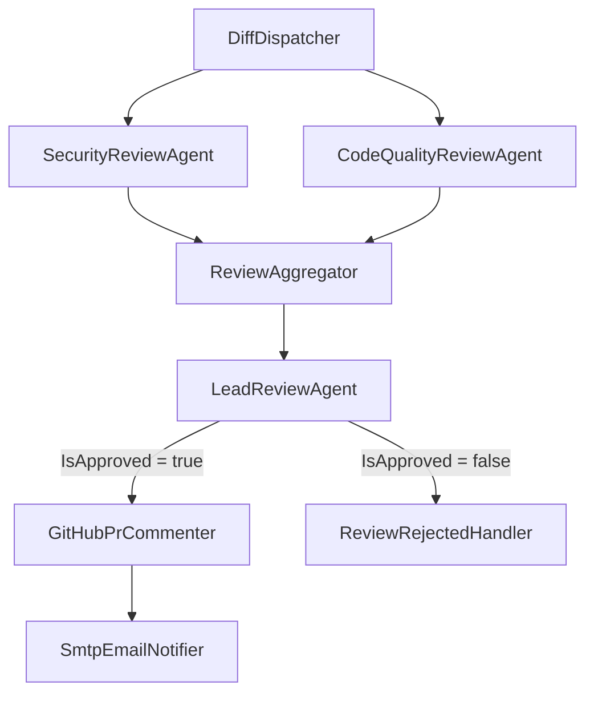

# CodeReviewAgents (.NET 10 + Microsoft Agent Framework)

Microsoft Agent Framework (`Microsoft.Agents.AI` + `Microsoft.Agents.AI.Workflows`) ile oluşturulmuş, **OpenRouter** destekli eşzamanlı (async concurrent) multi-agent Code Review workflow uygulaması.

## Workflow Mimarisi



1. **DiffDispatcher**: Git diff'ini alır (GitHub PR diff, yerel `git diff`, veya yerleşik örnek diff) ve iki uzman ajana paralel olarak dağıtır (`AddFanOutEdge`).
2. **SecurityReviewAgent & CodeQualityReviewAgent**: `AddFanOutEdge` ile aynı SuperStep içinde `InProcessExecution.Default` altında eşzamanlı çalışır.
3. **ReviewAggregator**: `AddFanInBarrierEdge` ile her iki ajanın tamamlanmasını bekler ve sonuçları tek pakette birleştirir.
4. **LeadReviewAgent**: Her iki ajanın bulgularını orijinal diff'e karşı denetler, yanlış pozitifleri eler, onaylar veya reddeder ve nihai Markdown PR yorumunu üretir.
5. **GitHubPrCommenter**: Yalnızca Lead Agent onaylarsa (`IsApproved == true`) GitHub PR'a yorum atar (Octokit).
6. **SmtpEmailNotifier**: PR yorumunu MailKit SMTP üzerinden e-posta olarak gönderir.

## Kurulum & Anahtarları (Key) Tanımlama

Anahtarları kaynak koduna yazmadan `dotnet user-secrets` veya ortam değişkenleri ile tanımlayabilirsiniz:

```bash
cd CodeReviewAgents

# 1. OpenRouter (Ücretsiz API Key)
dotnet user-secrets set "OpenRouter:ApiKey" "sk-or-v1-..."
# İsteğe bağlı model seçimi (varsayılan: google/gemma-4-26b-a4b-it:free)
dotnet user-secrets set "OpenRouter:Model" "google/gemma-4-26b-a4b-it:free"

# 2. GitHub PR Yorumu (gerçek PR'a yorum atmak için DryRun=false yapın)
dotnet user-secrets set "GitHub:Token" "ghp_..."
dotnet user-secrets set "GitHub:Owner" "kullanici-veya-org"
dotnet user-secrets set "GitHub:Repo" "repo-adi"
dotnet user-secrets set "GitHub:PullRequestNumber" "1"
dotnet user-secrets set "GitHub:DryRun" "false"

# 3. SMTP E-posta (gerçek mail göndermek için DryRun=false yapın)
dotnet user-secrets set "Smtp:Host" "smtp.gmail.com"
dotnet user-secrets set "Smtp:Port" "587"
dotnet user-secrets set "Smtp:Username" "ornek@gmail.com"
dotnet user-secrets set "Smtp:Password" "uygulama-sifresi"
dotnet user-secrets set "Smtp:FromEmail" "ornek@gmail.com"
dotnet user-secrets set "Smtp:ToEmail" "alici@example.com"
dotnet user-secrets set "Smtp:DryRun" "false"
```

## Çalıştırma

Sadece OpenRouter key ile hızlı deneme (GitHub & SMTP `DryRun: true` iken örnek diff ile çalışır):

```bash
OPENROUTER_API_KEY="sk-or-v1-..." dotnet run --project CodeReviewAgents
```

## GitHub Actions ile Her PR'da Otomatik İnceleme (Reusable Workflow)

Bu repo (public olduğu sürece) diğer tüm GitHub repolarından **Reusable Workflow** olarak çağrılabilir.

### 1. İncelenecek Repoya Secret Ekleme
Hedef repoda (ör. `appointment-ai-assistant`) **Settings → Secrets and variables → Actions → New repository secret** yolundan şu secret'ı ekleyin:
- `OPENROUTER_API_KEY`: OpenRouter API anahtarınız

> Ekstra GitHub PAT gerekmez; GitHub Actions'ın yerleşik `GITHUB_TOKEN`'ı `pull-requests: write` izniyle PR diff'ini okur ve PR'a yorum atar.

### 2. Hedef Repoya Workflow Dosyası Ekleme
İncelenecek repoda `.github/workflows/ai-code-review.yml` dosyasını oluşturun:

```yaml
name: AI Code Review

on:
  pull_request:
    types: [opened, synchronize, reopened]

permissions:
  contents: read
  pull-requests: write

jobs:
  ai-review:
    uses: mustafaalkan64/github-pr-commenter-maf-project/.github/workflows/reusable-code-review.yml@main
    with:
      openrouter_model: "google/gemma-4-26b-a4b-it:free" # İsteğe bağlı
    secrets:
      OPENROUTER_API_KEY: ${{ secrets.OPENROUTER_API_KEY }}
```

### Nasıl Çalışır?
- Yeni PR açıldığında (`opened`), PR'a yeni commit push edildiğinde (`synchronize`) veya tekrar açıldığında (`reopened`) otomatik tetiklenir.
- Aynı PR'da yeni bir commit geldiğinde önceki çalışmayı iptal eder (`concurrency.cancel-in-progress: true`) ve gizli yorum işaretçisi (`<!-- code-review-agents:ai-pr-review -->`) sayesinde yeni yorum eklemek yerine **mevcut AI yorumunu günceller**.
- GitHub Actions ortamında SMTP varsayılan olarak kapalıdır (`Smtp__DryRun: "true"`).
